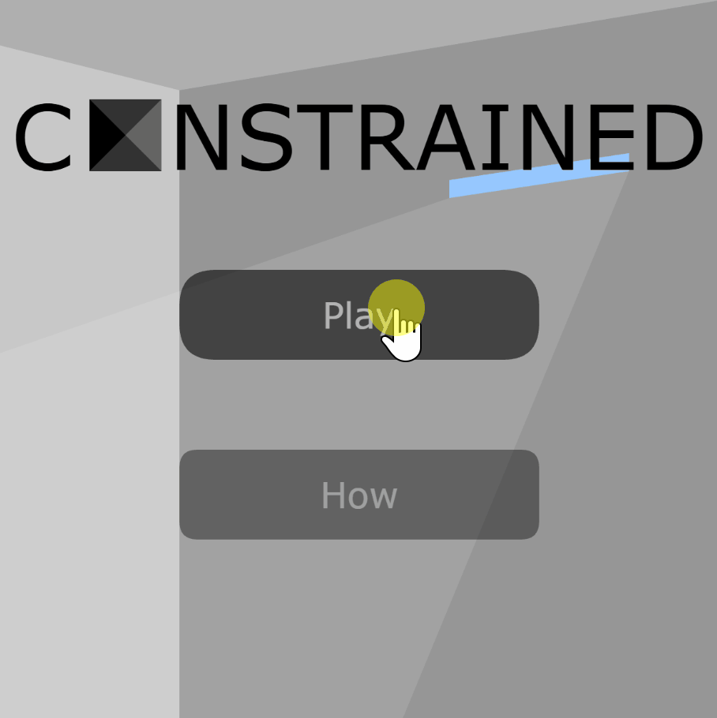

# 🎮 Constrained | Physics-Based 2D Platformer

> A browser-based 2D platformer, created in 2022, engineered in JavaScript using Processing.js, featuring trigonometric calculations and object-oriented collision logic.

## 🕹️ Play in Browser

**Play the live game directly:** [https://happyjasondev.github.io/platformer/](https://happyjasondev.github.io/platformer/)

## ⌨️ How to Play

Use the arrow keys or WASD keys to control a blue cube and escape from a building.
- You have infinite lives. The game resets immediately if you fail.
- Avoid gaps, spikes, acid, or bullets.
- Jump on trampolines to go higher.

## 🛠️ Technical Highlights & Architecture

* **Object-Oriented Architecture:** Designed player physics, level geometry, and environmental hazards to maintain clean, scalable code.
* **Trigonometric Projectile Tracking:** Applied $2\text{D}$ trigonometry (`Math.atan2`, `Math.sin`, `Math.cos`) to compute dynamic projectile angles, velocities, and trajectory angles toward target positions.
* **Algorithmic Level Generation:** Utilized nested iterative loops and array-based grid mapping to dynamically render static tiles, hazards (spikes, acid pools), and interactive elements (trampoline mechanics, turrets).
* **Responsive State Management:** Built a real-time event loop handling dynamic movement math (continuous tile collision detection, rapid reset-on-fail states) using standard WASD and arrow key controls.

## 🚀 Tech Stack

| Component | Technology |
| :--- | :--- |
| **Language** | JavaScript (ES6) |
| **Graphics Library** | Processing.js (PJS) |
| **Concepts Applied** | Object-Oriented Programming (OOP), Trigonometry, Game Physics, Array Iteration |

## ⚠️ Disclaimer

This project is provided "as is" for educational and portfolio demonstration purposes. The author is not responsible for any software issues or hardware incompatibilities that may arise during gameplay.

## 📋 Usage Note

Designed for short play sessions in web browsers. Standard breaks are recommended for comfortable gameplay.
